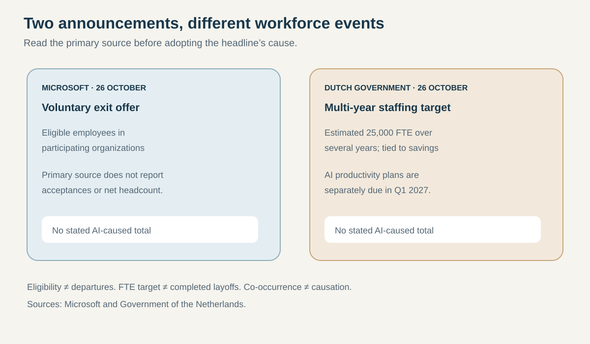
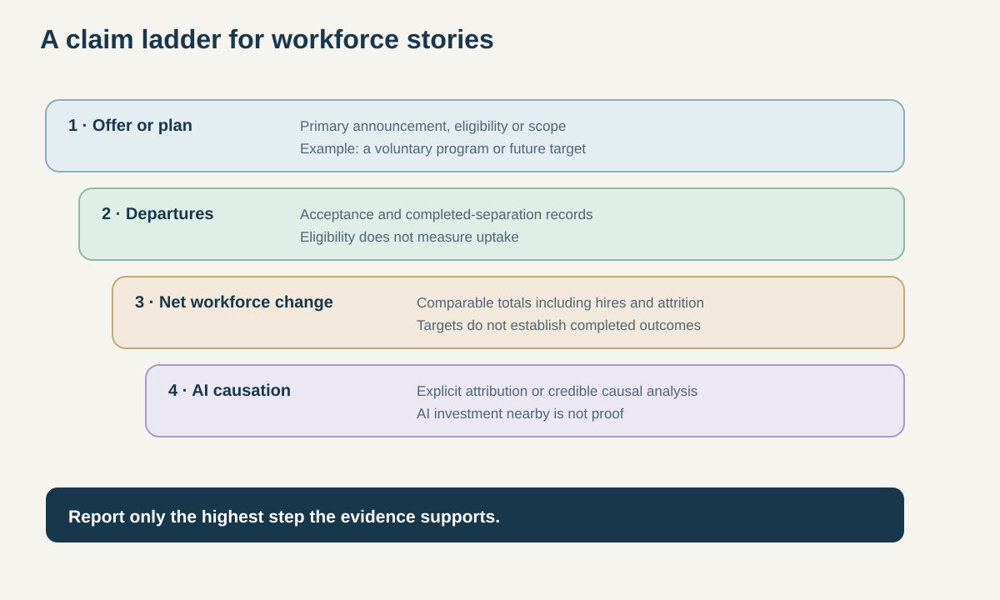
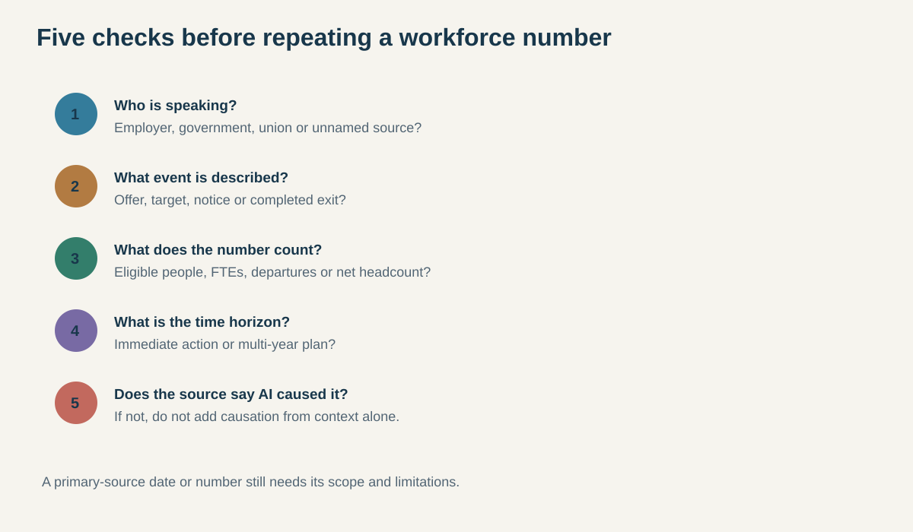

# Two workforce announcements, and why neither proves AI caused the cuts

**Dek:** Microsoft announced a voluntary exit offer; the Dutch government set a multi-year central-government staffing target while separately planning AI productivity goals. Neither announcement, as written by its primary source, establishes that AI caused a specific number of job losses.

**Byline:** Editorial Desk · **Reviewer:** Aman Mishra  
**Publication status:** Private draft; not published or scheduled  
**Prepared:** 31 October 2026 · **Updated:** 31 October 2026  
**Topic:** Work & Society · **Reading time:** 10 minutes

## The bottom line

Two workforce announcements published on 26 October are being discussed alongside artificial intelligence, but they describe different events. Microsoft’s official post announced a Voluntary Exit Offer for eligible employees in participating organizations. The Dutch government said it aims to reduce central-government staffing by an estimated 25,000 full-time equivalents over several years to meet savings targets; in a separate part of the same statement, it said AI productivity goals and savings plans would be set in the first quarter of 2027. [1][2]

Neither primary source says that AI is the cause of a specific number of departures. Microsoft’s post describes a voluntary option and organizational adaptation, not an AI-linked layoff count. The Dutch statement does not connect the 25,000-FTE target to AI; it places the AI productivity plan on a separate future timetable. The distinction is important because a voluntary offer, an announced staffing target and a realized involuntary layoff are not interchangeable. [1][2]

Some secondary coverage describes Microsoft’s offer as available to about 60,000 employees and links it to AI investment. Bloomberg’s headline describes the Dutch plan as an “AI-led” overhaul. Those are reported framings; the primary documents do not establish an equivalent AI-caused job-loss figure. [3–6]

## Start with the event, not the headline

View data

| Announcement | What the primary source says | What it does not establish |
|---|---|---|
| Microsoft, 26 October | Voluntary Exit Offer for eligible employees in participating organizations; a supported choice to leave | Number of acceptances, resulting net headcount, or AI as the stated cause |
| Netherlands, 26 October | Estimated 25,000-FTE central-government reduction over several years, tied to savings; AI productivity goals due in Q1 2027 | That the FTE target is an AI layoff plan or that 25,000 people have already left |

Sources: Microsoft and Dutch Government. [1][2]

The Microsoft communication came from Amy Coleman, the company’s executive vice president and chief people officer. It introduces a voluntary offer for eligible employees in participating organizations and says it is intended to give people considering a future outside the company a supported way to make that transition. The post also describes the offer as one way participating organizations can adapt their workforce to changing needs. [1]

That wording matters. A voluntary exit offer is not the same as an involuntary redundancy notice. It invites eligible employees to choose whether to leave under stated terms. The announcement alone does not tell readers how many people will accept, which roles will remain open, whether hiring will replace departures, or what the net headcount will be after the program. A figure describing who may be eligible is not a count of people who departed. [1][3–5]

Reuters, in a report carried by CBC, described the offer as covering about 60,000 employees and reported the participating countries. That figure is useful only with its attribution: it is a reported estimate of potential eligibility, not a count of applicants or completed exits. The company’s primary blog post confirms the offer but does not publish a total acceptance number or eventual headcount impact. [1][3]

The Dutch statement describes a different measure. The cabinet says it wants to make the central government “more capable, simpler, smarter and smaller,” estimating a reduction of 25,000 FTE over several years. The stated policy context is savings: €900 million in 2027, increasing to €3.5 billion from 2035. Police and defence are among the exceptions noted in the announcement. An FTE is a full-time-equivalent measure; it is not automatically the same as a count of individuals, a one-time layoff total or a number already realized. [2]

In the same statement, the cabinet says it will set goals and savings plans for using AI to improve productivity in Q1 2027. That is a future planning step. The statement does not say that the 25,000-FTE target was calculated from AI adoption, nor does it describe how the future AI plans will affect staffing. The timing and topic are related in the announcement, but proximity is not proof of a causal link. [2]

## A claim ladder for workforce stories

View data

| Claim level | Example | Evidence needed |
|---|---|---|
| Offer or plan | A voluntary exit program or multi-year target | Primary announcement and eligibility or scope |
| Individual departures | People accept offers or leave | Acceptance and separation data |
| Net workforce change | Headcount falls after hiring and attrition | Comparable before-and-after workforce records |
| AI causation | AI adoption caused a defined share of reductions | Employer statement or documented causal analysis |

An announcement supports only the level it actually documents.

The word “cuts” can conceal several different events. An employer may offer voluntary departures, eliminate vacant positions through attrition, announce a target for future staffing, issue involuntary layoff notices, or report a completed reduction. The first is an option; the second a staffing policy; the third a plan; the fourth a set of employment actions; and the fifth an outcome. They require different evidence.

The same applies to causal language. “AI was mentioned in the same announcement” is not the same as “AI caused the reduction.” A source can state that a company is investing in AI while also reducing costs, but that does not show how much of a particular workforce action was caused by automation, restructuring, a product shift, a budget target or another factor. A causal claim requires the employer to make that connection or independent analysis to test it.

The Dutch government’s statement is especially clear about the unresolved link: it sets out the staffing and savings objective, then separately says AI productivity plans will be prepared in Q1 2027. Until those plans are published, readers do not know how the government will measure AI-driven productivity, which departments will use it, or whether it will change staffing levels. The official statement does not answer those questions. [2]

## What the secondary headlines add—and what they don’t

Some coverage places these announcements in the context of AI spending or efficiency. The Reuters/CBC report says Microsoft’s offer comes as the company seeks to contain costs and help fund AI investment. The New York Times similarly places the offer beside Microsoft’s large AI spending plans. Bloomberg’s headline describes the Dutch government’s plan as an AI-led overhaul. [3–6]

These sources can document how the announcements were reported and what company or government representatives told journalists. But a report’s framing is not a substitute for the underlying statement. The official Microsoft post does not identify AI as the reason for the VEO. The Dutch government’s statement does not say AI is the reason for its FTE target. Readers should not turn “alongside AI investment” or “AI-led” in a headline into a primary-source attribution that is absent from the official document. [1–6]

This distinction is not a claim that AI has no effect on work. It is a limit on what the two October announcements prove. The International Labour Organization’s research measures occupational exposure to generative AI using task-level analysis and expert input; exposure is not the same as a forecast that a job will disappear. OECD work on automation risks and AI’s workplace effects also studies broader trends, not the cause of a particular employer’s October decision. These studies provide context, not a causal audit of Microsoft or the Dutch civil service. [7][8]

Even when a study estimates that many tasks may be changed by AI, it does not tell us whether a given employer will replace a person, reassign work, increase output, reduce hours, change hiring or do nothing. The bridge from technical capability to a labor-market outcome runs through adoption, job design, demand, regulation, worker bargaining and management choices. A headline that skips those steps can overstate what an exposure estimate means.

## Comparing the announcements fairly

View data

| Check | Microsoft VEO | Dutch government plan |
|---|---|---|
| Speaker | Chief People Officer | Cabinet / central government |
| Event type | Voluntary offer | Estimated multi-year FTE target |
| Time horizon | Offer announcement; uptake not yet known | Several years; detailed plan not published |
| AI named as cause? | Not in the official post | Not as cause of 25,000-FTE target |
| Outcome known? | No completed departure count | No realized 25,000-FTE outcome |

Sources: primary statements checked 31 October 2026. [1][2]

A useful workforce report should answer five questions before it uses a number:

1. **Who is speaking?** A company’s public statement, a government budget document, a union estimate and an unnamed source have different evidentiary weight.
2. **What event is described?** An offer, a target, a notice and a completed exit are separate events.
3. **What does the number count?** Eligible employees, positions, FTEs, acceptances, separations and net headcount are not synonyms.
4. **What is the time horizon?** A multi-year target should not be written as a same-day reduction.
5. **Does the source say AI caused it?** If it does not, do not add causation based on a nearby AI investment or an AI-themed headline.

Applied here, the answers are limited. Microsoft’s offer is voluntary and the final uptake is unknown. The company’s official post does not give an eventual departure count or connect the offer to AI. The Dutch government’s number is an estimated multi-year FTE target tied to savings, while its AI productivity work remains a future planning process. Neither is evidence that a stated number of jobs has already been eliminated by AI. [1][2]

## What this means for…

**Employees:** Check the terms of an offer, not just the number of people who may be eligible. A voluntary program’s effect depends on acceptance, role coverage, replacement hiring and any later restructuring.

**Public-sector workers:** A government FTE target is not necessarily an immediate dismissal notice. Follow the detailed workforce plan, department-level implementation and formal labor processes as they are published.

**Investors:** Separate costs, capital expenditure, voluntary departures and realized headcount changes. A large AI investment can coexist with workforce changes without proving one caused the other.

**Policy makers:** Publish the baseline, time horizon, exemptions, implementation method and metrics used to distinguish attrition, vacancies, layoffs and productivity gains.

**Journalists:** Use “eligible for an offer” for eligibility figures, “target” for a future staffing goal, “departed” only for completed separations, and “AI-caused” only when supported by evidence.

## What we don’t know yet

- How many Microsoft employees will accept the voluntary offer, and what the net headcount change will be.
- Whether the Dutch 25,000-FTE target will be delivered through attrition, vacancy reductions, redeployment, voluntary exits, involuntary departures or a mix.
- What the Dutch government’s Q1 2027 AI productivity goals will measure or how they relate to staffing.
- Whether either organization will publish evidence that attributes a specific workforce outcome to AI adoption.

The official announcements do not settle those questions. An estimate or plan should not be upgraded to an outcome until the employer or government reports implementation data. Likewise, a temporal link between AI strategy and workforce changes does not establish the share, mechanism or timing of any AI-related job effect.

## What to watch next

- **Microsoft:** any update on program uptake, completed departures and the resulting workforce total.
- **The Netherlands:** the detailed staffing plan, the Q1 2027 AI productivity goals and the government’s method for measuring them.
- **Both cases:** evidence separating departures from new hiring, attrition and changes in vacant positions.
- **AI and work research:** studies that measure actual adoption and employment outcomes, not exposure alone.

## FAQ

### Did Microsoft announce 60,000 layoffs?
No. Microsoft announced a voluntary exit offer for eligible employees in participating organizations. Reuters, in a report carried by CBC, described about 60,000 employees as potentially covered; that is an eligibility estimate, not a count of people who accepted or left. The company’s official post does not report completed departures or an eventual net headcount change.

### Is the Dutch government cutting 25,000 jobs because of AI?
The government statement does not say that. It describes an estimated 25,000-FTE central-government reduction over several years to support savings targets, and separately says AI productivity goals and plans will be set in Q1 2027. The official announcement does not establish AI as the cause of the staffing target.

### What does FTE mean in the Dutch target?
FTE means full-time equivalent, a measure of workload or staffing capacity expressed as full-time positions. It is not automatically a count of individual employees, immediate dismissals or completed departures. The Dutch government describes an estimated target over several years; implementation details and realized workforce changes require later evidence.

### Does AI exposure research prove that these reductions are AI-caused?
No. Studies of task or occupational exposure describe where AI may affect work. They do not establish whether Microsoft’s offer or the Dutch staffing target was caused by AI. That requires evidence about the particular decision, adoption, workforce outcomes and the employer’s stated reasons or a credible causal analysis.

### What evidence would confirm an AI-caused workforce reduction?
A clear employer or government statement linking a defined reduction to AI would help, but a causal claim should also identify the affected roles, period and number, and distinguish AI from other factors such as budgets or restructuring. An offer, target, AI investment or exposure estimate alone cannot establish a completed AI-caused job loss.

## Sources

**Tier 1 — primary / official and research**

1. Microsoft, *Introducing a Voluntary Exit Offer*, 26 October 2026. https://blogs.microsoft.com/blog/2026/10/26/introducing-a-voluntary-exit-offer/
2. Government of the Netherlands, *Cabinet works towards a capable government: simpler, smarter and smaller*, 26 October 2026. https://www.rijksoverheid.nl/actueel/nieuws/2026/10/26/kabinet-werkt-aan-slagvaardige-overheid-eenvoudiger-slimmer-en-kleiner
7. International Labour Organization, *Generative AI and Jobs: A Refined Global Index of Occupational Exposure*, 2025. https://www.ilo.org/publications/generative-ai-and-jobs-refined-global-index-occupational-exposure
8. OECD, *OECD Employment Outlook 2023: Artificial Intelligence and the Labour Market*. https://www.oecd.org/en/publications/oecd-employment-outlook-2023_08785bba-en.html

**Tier 2 — independent reporting**

3. Reuters, carried by CBC, *Microsoft gives voluntary buyout offer to about 60,000 employees*, 26 October 2026. https://www.cbc.ca/lite/story/9.7396520
4. Associated Press, *Microsoft offers buyouts to 60,000 employees*, 26 October 2026. https://apnews.com/article/microsoft-buyout-ai-layoff-xbox-c5a639f53615be198db1799adf6837e1
5. Karen Weise, *Microsoft Offers Buyouts to 60,000 Employees as It Spends on A.I.*, The New York Times, 26 October 2026. https://www.nytimes.com/2026/10/26/technology/microsoft-buyouts-ai-spending.html
6. Patrick van Oosterom, *Dutch Government Plans to Cut 25,000 Jobs in AI-Led Overhaul*, Bloomberg, 26 October 2026. https://www.bloomberg.com/news/articles/2026-10-26/dutch-government-plans-to-cut-25-000-jobs-in-ai-led-overhaul

## Methodology note

This draft and its research were AI-assisted. Microsoft and the Dutch government are treated as primary sources for their own programs and targets. Secondary coverage is cited to explain reported figures and framing, not to replace the primary statements. The ILO and OECD sources provide general labor-market context, not a causal assessment of either announcement. Checked 31 October 2026. Global AI News has no commercial relationship with the entities discussed.

## Corrections log

No corrections recorded. Private draft; not published.

## Related coverage

- [Hosted APIs versus open-weight models](https://www.globalainews.in/reports/hosted-vs-open-weight-models/)
- [AI assistants compared](https://www.globalainews.in/reports/ai-assistants-compared/)
- [Coding-agent benchmark comparisons](https://www.globalainews.in/reports/coding-agent-benchmarks-compared/)
- [Global AI News research register](https://www.globalainews.in/research/)

## Subscribe

Subscribe to Global AI News for source-linked reporting on AI, work and society.
