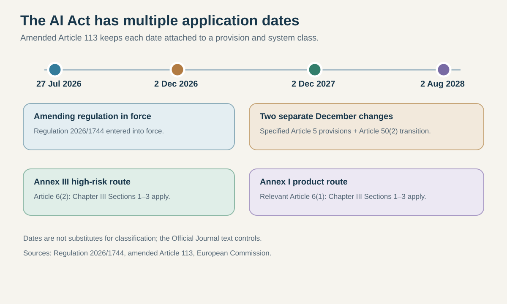
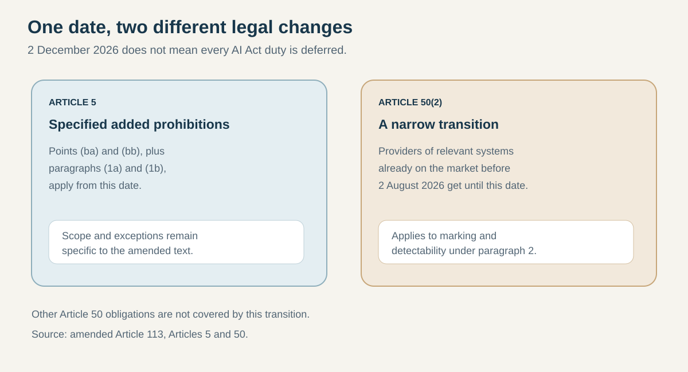
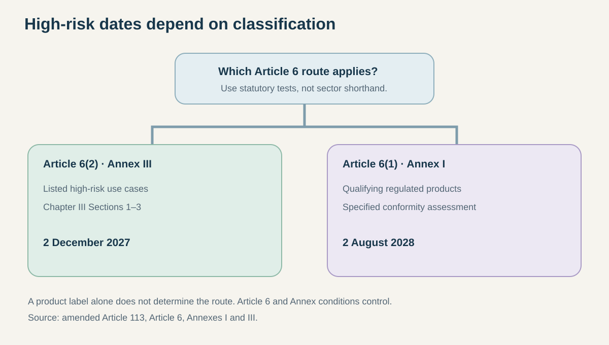

# The EU AI Act has several dates—not one delayed deadline

**Dek:** Regulation 2026/1744 keeps separate application dates for new Article 5 prohibitions, a transition for Article 50(2) marking duties, and two classes of high-risk systems. Which date matters depends on the obligation and the system.

**Byline:** Editorial Desk · **Reviewer:** Aman Mishra  
**Publication status:** Private draft; not published or scheduled  
**Prepared:** 31 October 2026 · **Updated:** 31 October 2026  
**Topic:** Policy & Compliance · **Reading time:** 9 minutes

## The bottom line

There is no single new “AI Act deadline.” Regulation (EU) 2026/1744, the AI Omnibus amendment, entered into force on 27 July 2026, but its changes do not move every AI Act duty to one later date. The amended Article 113 distinguishes at least three timelines: specified new prohibitions under Article 5 apply from 2 December 2026; certain providers have until that date to meet the Article 50(2) marking obligation for systems already on the market before 2 August 2026; and high-risk obligations under Chapter III Sections 1–3 start on different dates for Annex III and Annex I systems. [1–3]

The high-risk dates are 2 December 2027 for systems classified under Article 6(2) and Annex III, and 2 August 2028 for relevant Article 6(1) systems connected to Annex I regulated products. Those are not interchangeable categories. A system’s intended use, product context and legal classification determine which row is relevant. [3][6–8]

This is a date guide, not a legal classification or compliance opinion. It does not assess any individual system, provider or deployment. The operative regulation and the facts of a particular use case control. [1–9]

## First, separate “entry into force” from “application”

View data

| Date | What it means in the amended schedule |
|---|---|
| 27 July 2026 | Regulation 2026/1744 enters into force |
| 2 August 2026 | AI Act’s broader application date, subject to staged exceptions |
| 2 December 2026 | Specified new Article 5 provisions apply; Article 50(2) transition ends for relevant pre-existing systems |
| 2 December 2027 | Chapter III Sections 1–3 apply to Article 6(2)/Annex III high-risk systems |
| 2 August 2028 | Chapter III Sections 1–3 apply to relevant Article 6(1)/Annex I systems |

Sources: amended Article 113 and the European Commission’s dated timeline. [1–3][9]

“Entry into force” and “application” answer different questions. The European Commission says the AI Omnibus entered into force on 27 July 2026. The AI Act’s application is staged: some parts already applied before that date, and other obligations begin later under Article 113. A regulation can be legally in force while an obligation it amends is not yet applicable to a particular category. [1–3]

## The December 2026 row has two separate jobs

View data

| Provision | Date | Scope to keep attached |
|---|---|---|
| Article 5(1), points (ba) and (bb), and paragraphs (1a) and (1b) | 2 December 2026 | Specified added prohibited-practice provisions; use the amended text for scope and exceptions |
| Article 50(2) | 2 December 2026 for relevant systems already on the market before 2 August 2026 | Transition for providers’ machine-readable marking and detectability duties |
| Other Article 50 duties | 2 August 2026 application date, subject to the Act’s specific scope | Do not describe every transparency duty as deferred |

Sources: Article 113, Article 5 and Article 50. [3–5]

The Article 50(2) transition is narrow. Article 50(2) concerns providers of AI systems—including general-purpose AI systems—that generate synthetic audio, image, video or text content. The obligation is to ensure outputs are marked in a machine-readable format and detectable as artificially generated or manipulated. Under amended Article 113, providers of systems placed on the market before 2 August 2026 have until 2 December 2026 to comply with that paragraph. [3][4]

That does not postpone all Article 50 transparency duties. Article 50 contains several obligations for different actors and system situations, including disclosures related to AI interaction and generated or manipulated content. The article’s other provisions have their own scope and dates. The transition described here attaches to Article 50(2) and the systems already on the market before 2 August; it should not be used as a blanket extension for every transparency requirement. [3][4]

The same December date also appears in Article 113 for specified additions to Article 5. Those provisions concern new prohibited practices, but the deadline is not a single general-purpose “AI safety” date. The amendment lists specific points and paragraphs, and the amended Article 5 text contains scope conditions and exceptions. This explainer records the application date without trying to decide whether a particular tool, output or use falls within those legal tests. [1][3][5]

## High-risk systems: classify the route before reading the date

View data

| Classification route | Main reference | Application date for Chapter III Sections 1–3 |
|---|---|---|
| Article 6(2) high-risk use cases | Annex III | 2 December 2027 |
| Relevant Article 6(1) systems in regulated products | Annex I | 2 August 2028 |

The system must meet the legal classification tests. A domain label alone is not a determination. [3][6–8]

Article 6 provides two routes to high-risk classification. Article 6(2) points to use cases listed in Annex III. Article 6(1) concerns AI systems that are products, or safety components of products, covered by the Union harmonisation legislation listed in Annex I and subject to third-party conformity assessment under that legislation. The categories are not simply “software versus hardware,” and the relevant date follows the classification route in the law. [3][6–8]

For the Article 6(2)/Annex III route, Chapter III Sections 1–3 apply from 2 December 2027. Those sections cover high-risk classification rules and the main requirements and obligations for high-risk systems. The Commission’s summary groups the date with high-risk use cases in areas such as biometrics, critical infrastructure, education, employment, essential services, law enforcement, migration, justice and democratic processes. A concrete system still needs to be tested against Article 6 and the relevant Annex III entry, including applicable conditions and exceptions. [3][6][8][9]

For the Article 6(1)/Annex I route, the equivalent Chapter III Sections 1–3 date is 2 August 2028. The scope is tied to qualifying systems embedded in regulated products and to the conformity-assessment conditions specified in Article 6(1). It is not a general two-year extension for every product that contains software or AI. [3][6][7][9]

The timeline also does not mean organizations can wait until these dates to do all related work. Contracts, documentation, risk processes, procurement requirements and other laws may require action sooner. The dates in Article 113 identify when the listed AI Act provisions apply to the specified categories; they do not pause other legal duties or operational preparation. [1][3]

## A practical four-question check

Before assigning a date, an organization should document four points:

1. **Which obligation?** Identify the specific AI Act article and paragraph, not a general label such as “transparency” or “high-risk.”
2. **Which actor?** The duty may attach to a provider, deployer, importer, distributor or another actor.
3. **Which system and use?** Record the system’s intended purpose, market status and the facts relevant to its classification.
4. **Which transition?** Check whether the system was already on the market before a cutoff date and whether the transitional clause applies to that exact provision.

This checklist is a reporting aid, not a substitute for the regulation. It prevents a common mistake: copying a date from a headline without carrying over the obligation, actor and system category that make the date meaningful. The amendment is specific enough that a single “AI Act deadline” calendar can hide important legal differences. [1][3]

## Common date mistakes

**“All AI Act duties were delayed.”** No. Regulation 2026/1744 changes specified dates. Other provisions remain on their original application schedule, and some have already applied. [1–3]

**“Every Article 50 transparency duty starts in December.”** No. The transition described in Article 113 applies to Article 50(2) for providers of relevant systems already on the market before 2 August 2026. It is not a blanket transition for all Article 50 duties. [3][4]

**“High-risk systems all start in December 2027.”** No. The date differs by classification route: 2 December 2027 for Article 6(2)/Annex III and 2 August 2028 for relevant Article 6(1)/Annex I systems. [3][6–9]

**“A product sector alone decides the date.”** Not necessarily. A classification depends on statutory conditions, intended purpose and the applicable Annex entry. The AI Act’s own tests—not a company’s shorthand or a broad industry label—determine which route applies. [3][6–8]

## What this means for…

**AI providers:** Map each system to the exact obligation, actor and transition. For Article 50(2), distinguish a system already on the market before 2 August 2026 from one placed on the market later.

**Product manufacturers:** Check whether an AI system is a safety component or product under the relevant Annex I legislation and whether a third-party conformity assessment is required. Do not assume every AI-enabled product follows the 2028 date.

**Deployers and buyers:** Ask vendors which version, system and legal actor their date statement covers. A provider’s transitional date may not answer every deployer’s obligations or procurement commitments.

**Policy and compliance teams:** Maintain a provision-level calendar. Keep the December 2026 changes, Annex III date and Annex I date in separate rows, with an owner and evidence source for each classification.

**Journalists:** Attribute dates to Article 113 as amended. Avoid “delayed AI Act” headlines that do not identify the provision and affected category.

## What we don’t know yet

The regulation sets dates; it does not classify every commercial product in advance. For a specific system, the missing facts may include its intended purpose, whether it meets an Annex entry, whether it is a safety component, which actor has the duty, whether it was already on the market before the relevant cutoff and whether an exception applies. These are case-specific legal questions.

This article therefore does not determine whether a named product is high-risk, prohibited or exempt. The relevant legal text and competent authorities should be consulted for a specific deployment. The Commission’s AI Act Service Desk is an official explanatory resource, but its summaries state that they are not legally binding; the Official Journal text controls. [1][3–9]

## What to watch next

- **Before 2 December 2026:** check for updated Commission guidance on the Article 50(2) transition and the specific Article 5 additions. A general explainer should not replace the amended text.
- **For high-risk systems:** watch for the Commission’s implementation guidance, standards and any updates to the consolidated AI Act. These can clarify how the statutory requirements are applied, but they do not change the dates unless the law changes.
- **For a specific product:** preserve a dated record of its intended purpose, market status, role in a regulated product and assessment route. Revisit that record if the system, deployment or legal text changes.
- **For reporting:** verify the Official Journal version in force at the time of publication. A later amendment or correction could change a date or scope.

Maintain a provision-level calendar naming the actor, system category, application date and legal source. Recheck the Official Journal before publication; future amendments could change dates or scope.

## FAQ

### What changed on 27 July 2026?
Regulation (EU) 2026/1744, the AI Omnibus amendment, entered into force on 27 July 2026. It amended the AI Act’s timetable for specified obligations rather than replacing the Act’s overall schedule. Article 113 now sets distinct dates for new Article 5 provisions, an Article 50(2) transition and two high-risk system categories.

### Does the 2 December 2026 date defer all Article 50 duties?
No. The transition in amended Article 113 applies to providers’ Article 50(2) marking duties for systems placed on the market before 2 August 2026. Article 50 contains other transparency obligations with their own scope. The transition should not be described as a blanket extension for every Article 50 requirement.

### Which high-risk systems follow the 2027 date?
Chapter III Sections 1–3 apply from 2 December 2027 to systems classified under Article 6(2) and listed in Annex III. This date is tied to that legal route, not to every system described informally as high-risk. Classification depends on the statutory conditions and the system’s intended purpose.

### Which systems follow the 2028 date?
The 2 August 2028 date applies to relevant Article 6(1) systems connected to products covered by the Annex I legislation and subject to the specified third-party conformity assessment. It is not a general extension for all software, devices or AI-enabled products. The legal classification tests still control.

### Is this legal advice for a specific product?
No. This is a dated explainer of the application schedule, not a legal opinion or product classification. Determining whether a particular system is prohibited, high-risk, in transition or exempt requires facts about its purpose, market status, role in a product and applicable legal conditions. The Official Journal text controls.

## Sources

**Tier 1 — official legal text and EU guidance**

1. European Parliament and Council, Regulation (EU) 2026/1744, Official Journal, 24 July 2026. https://eur-lex.europa.eu/eli/reg/2026/1744/oj/eng
2. European Commission, *AI Omnibus enters into force*, 27 July 2026. https://digital-strategy.ec.europa.eu/en/news/ai-omnibus-enters-force
3. European Commission AI Act Service Desk, consolidated AI Act Article 113 (text as at 27 July 2026). https://ai-act-service-desk.ec.europa.eu/en/ai-act/article-113
4. European Commission AI Act Service Desk, Article 50: transparency obligations for providers and deployers. https://ai-act-service-desk.ec.europa.eu/en/ai-act/article-50
5. European Commission AI Act Service Desk, Article 5: prohibited AI practices, amended text. https://ai-act-service-desk.ec.europa.eu/en/ai-act/article-5
6. European Commission AI Act Service Desk, Article 6: classification rules for high-risk AI systems. https://ai-act-service-desk.ec.europa.eu/en/ai-act/article-6
7. European Commission AI Act Service Desk, Annex I: Union harmonisation legislation. https://ai-act-service-desk.ec.europa.eu/en/ai-act/annex-1
8. European Commission AI Act Service Desk, Annex III: high-risk use cases. https://ai-act-service-desk.ec.europa.eu/en/ai-act/annex-3
9. European Commission, *Regulatory framework for artificial intelligence*. https://digital-strategy.ec.europa.eu/en/policies/regulatory-framework-ai

## Methodology note

This draft and its research were AI-assisted. It is general legal information, not legal advice or a product-specific classification. The Official Journal and consolidated regulation control over explanatory summaries. Dates and interpretations were checked on 31 October 2026; later amendments or official guidance may change the analysis.

## Corrections log

No corrections recorded. Private draft; not published.

## Related coverage

- [Hosted APIs versus open-weight models](https://www.globalainews.in/reports/hosted-vs-open-weight-models/)
- [AI assistants compared](https://www.globalainews.in/reports/ai-assistants-compared/)
- [Coding-agent benchmark comparisons](https://www.globalainews.in/reports/coding-agent-benchmarks-compared/)
- [Global AI News research register](https://www.globalainews.in/research/)

## Subscribe

Subscribe to Global AI News for source-linked reporting on AI law, policy and implementation.
