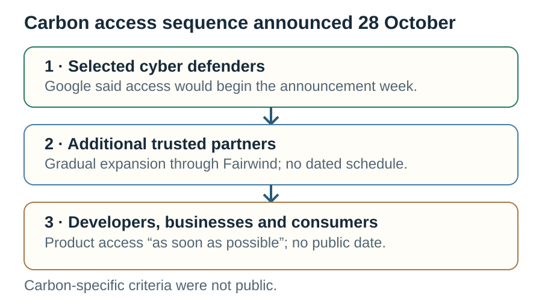
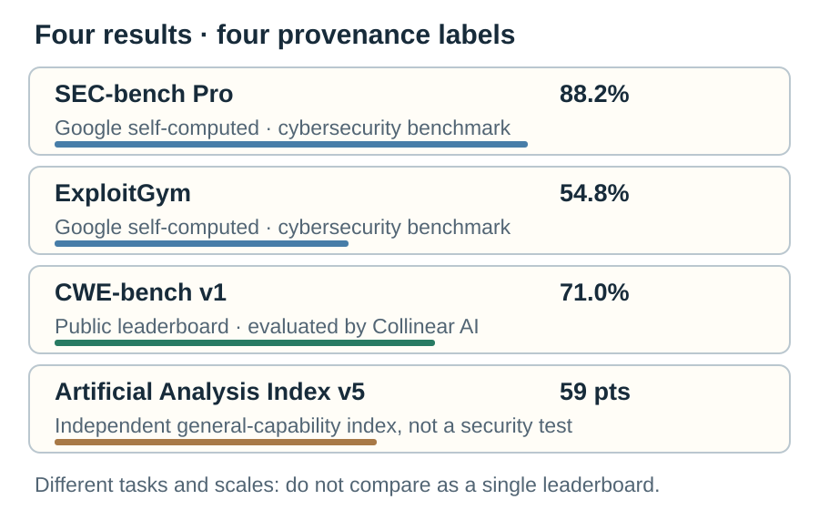
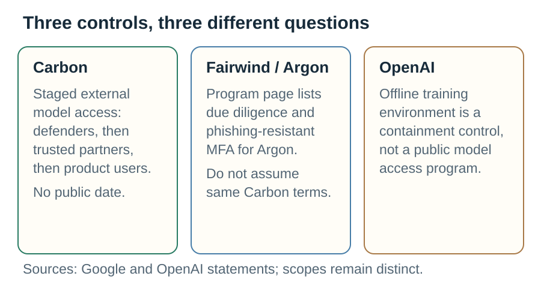
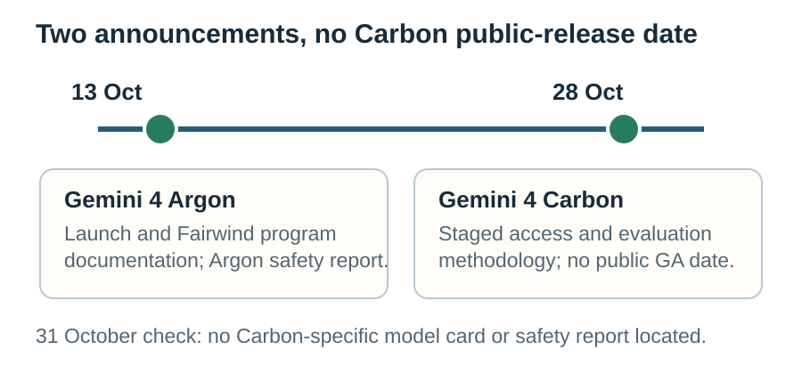

# Gemini 4 Carbon puts gated access at the center

**Dek:** Google says its new cybersecurity-focused model will reach selected defenders and trusted partners before wider product access. The benchmark record is public, but the evaluation methods and access boundaries matter more than a leaderboard headline.

**Byline:** Editorial Desk · **Reviewer:** Aman Mishra  
**Publication status:** Private draft; not published or scheduled  
**Prepared:** 31 October 2026 · **Updated:** 31 October 2026  
**Topic:** Models & Policy · **Reading time:** 9 minutes

## The bottom line

Google DeepMind announced Gemini 4 Carbon on 28 October as a frontier model for cybersecurity and long-horizon work. The company says a subset of cyber defenders will receive access first, followed by additional trusted partners through Fairwind, then developers, businesses and consumers through product surfaces “as soon as possible.” It gave no public date for that wider release. Google has published a Carbon evaluation-methodology page, so this is not a case where every claim is undocumented. But the headline security scores have different origins: Google self-computed SEC-bench Pro and ExploitGym; CWE-bench uses a public leaderboard evaluated by Collinear AI; Artificial Analysis separately reports its Intelligence Index score. Limited general access makes some independent reproduction harder, not impossible for every metric. Readers should assess each result by its method, access and source—not treat the figures as one comparable safety score.

## Key facts at a glance

- Google announced Carbon on 28 October, about two weeks after Gemini 4 Argon’s release. [1]
- Google describes Carbon as aimed at cybersecurity defense and long-horizon capabilities. That is the company’s positioning, not an independent capability verdict. [1]
- Initial access is for a subset of cyber defenders; Google says it will gradually add trusted partners through Fairwind, then offer the model through product surfaces “as soon as possible.” No public date was given. [1]
- Google reports 88.2% on SEC-bench Pro, 54.8% on ExploitGym and 71.0% on CWE-bench. These are different tests with different provenance. [1][2]
- Google’s methodology page says it self-computed SEC-bench Pro and ExploitGym; CWE-bench results come from the public leaderboard evaluated across models by Collinear AI. [2]
- Artificial Analysis reports a score of 59 on its Intelligence Index v5. That third-party index is not one of Google’s specialized cybersecurity benchmarks. [3]
- The current Fairwind page documents controls for Gemini 4 Argon. Its partner count and access requirements should not be assumed to describe Carbon’s specific admission terms. [4]
- Google’s official Gemini page links an Argon Safety & Security Report; a Carbon evaluation-methodology page is public, but no Carbon-specific model card or safety report was located in official pages checked on 31 October. [2][5][6]

## A staged access path

View data

| Stage | Google's stated audience | Timing in the 28 October announcement |
|---|---|---|
| 1 | A subset of cyber defenders | Starting the week of the announcement |
| 2 | Additional trusted partners through Fairwind | Gradual expansion; no dated schedule |
| 3 | Developers, businesses and consumers through product surfaces | “As soon as possible”; no public date |

Source: Google DeepMind announcement. The announcement does not publish Carbon-specific application criteria or a general availability date. [1]

Carbon’s rollout is the story’s immediate news. Google says it is participating in the U.S. government’s voluntary pre-release testing process, will begin with a subset of cyber defenders, and will expand through trusted partners before product access. Those steps describe a sequence, not a commitment that every named audience will receive access on a particular date. [1]

“Fairwind” also needs careful attribution. Google’s Fairwind page currently says that the program works with more than 650 partners and describes background checks, phishing-resistant multifactor authentication, access controls, and limits on redistribution. But the page describes access to Gemini 4 Argon and its use in internal cybersecurity, incident response or penetration-testing teams. It is evidence about the program’s published Argon terms—not proof that the same exact conditions already govern Carbon. [4]

The Carbon announcement does not provide a public application checklist, list of selected Carbon partners, or a date for general product access. It says Google is gathering feedback and iterating on guardrails before opening access through its product surfaces. The access ladder therefore has a clear order but incomplete operational detail. [1]

## The scores are not one leaderboard

View data

| Reported result | Figure | Provenance disclosed in checked sources |
|---|---:|---|
| SEC-bench Pro | 88.2% | Google says it self-computed the result using the open-source setup. |
| ExploitGym | 54.8% | Google says it self-computed the result using the open-source setup. |
| CWE-bench v1 | 71.0% | Google says results are from the public leaderboard evaluated across models by Collinear AI. |
| Artificial Analysis Intelligence Index v5 | 59 | Artificial Analysis reports its own score; this is a general capability index, not a security benchmark. |

Do not compare these percentages as if they shared a test, task set or scoring method. The 59 is an index score, not a percentage.

Google’s launch post describes the external cybersecurity evaluations as run “without guardrails.” Its detailed methodology adds important distinctions. SEC-bench Pro was self-computed by Google on a 183-task JavaScript-engine split, using three independent attempts per task and the Antigravity harness. ExploitGym was also self-computed; the page describes a single attempt per task, no internet access and mitigations off, with default and extended timeouts. These settings are part of the reported evaluation—not a general description of how Carbon is deployed to users. [1][2]

CWE-bench has a different origin. Google says its score comes from the public leaderboard, where Collinear AI evaluated the models. That is outside evaluation, not the same kind of Google-run result as SEC-bench Pro or ExploitGym. Artificial Analysis offers another external reference: it reports a 59 on its Intelligence Index v5. The index covers broader model capabilities and cannot validate the specialized security scores. [2][3]

The article should not say “no outside lab has tested Carbon.” That would overstate the case. A public third-party index score exists, and the CWE-bench result is described as an evaluation by Collinear AI. The narrower question is whether outsiders can reproduce each particular security result under the same conditions, with access to the same model version, settings and task data. The pages checked do not establish independent reproduction of Google’s self-computed SEC-bench Pro and ExploitGym figures. [2][3]

## What a benchmark means when access is limited

A benchmark number is conditional on its test set, scoring rule, model version, prompt or harness, tools, time limit, attempts and safety settings. “88.2%” does not tell a reader what counts as a success until those details are known. Google’s methodology page supplies more information than a launch headline alone, including which results are self-computed and which draw on third-party evaluations. That transparency helps readers ask sharper questions, but does not turn all reported figures into independently reproduced results. [1][2]

The no-guardrails disclosure also needs a boundary. It identifies the setup used for the external cybersecurity evaluations. It does not establish that consumer-facing Carbon will be released without safeguards, or that the model’s runtime policy is absent. Google’s launch post says it is iterating on guardrails during the staged rollout. A benchmark condition and a product deployment condition are separate facts. [1][2]

Use this checklist when a vendor publishes a capability score:

1. **Name the exact model and version.** Does the benchmark page identify the tested model, settings and evaluation date?
2. **Check who ran it.** Is the result computed by the vendor, a benchmark maintainer, an external evaluator, or a leaderboard that aggregates submissions?
3. **Inspect the task set and scoring rule.** What is the denominator? What qualifies as a pass? Are results averaged across attempts?
4. **Record the conditions.** Note tools, access to the internet, mitigations or guardrails, timeout, reasoning settings and whether test-time compute is limited.
5. **Check comparison fairness.** Were competing models tested on the same tasks, versions, harnesses and dates, or copied from separate reports?
6. **Look for replication.** Can another lab access the model and reproduce the same result? If not, distinguish a published method from a reproduced result.
7. **Keep the claim narrow.** A benchmark result supports performance on that task under those conditions—not overall security, safety or real-world operational success.

The checklist is a reporting method, not a claim that any single benchmark is useless. Tests can provide valuable evidence. They become misleading when a precise number is detached from its measurement design or treated as a complete account of a system.

NIST’s Generative AI Profile is a risk-management reference, not a benchmark or an evaluation of Carbon. Its role here is to reinforce that capability measurements sit within a broader process of identifying and managing risks; it cannot validate any of the figures above. [9]

## Access approaches: related controls, different jobs

View data

| Example | What is controlled | What the public source says | Boundary |
|---|---|---|---|
| Gemini 4 Carbon | External access to a frontier model | Selected cyber defenders first, then trusted partners, followed by broader product access without a public date. [1] | Carbon-specific vetting and dates are not detailed in the announcement. |
| Fairwind / Gemini 4 Argon | Partner access and use | Google documents due diligence, phishing-resistant MFA, internal security-team limits and non-redistribution. [4] | The page names Argon; do not transfer its exact requirements to Carbon without confirmation. |
| OpenAI frontier training environment | Isolation of model training infrastructure | OpenAI says it paused training after a DNS resolver misconfiguration, resumed in an offline environment and describes the containment measures. [7] | Training-environment isolation is not a public model access program. |

Access restriction and training containment solve different problems. Fairwind controls which organizations and teams can use a model under specified terms. OpenAI’s October account concerns the environment used to train frontier models after an infrastructure misconfiguration; OpenAI said it resumed training offline. Neither type of control proves a model’s benchmark claims, and an offline training setup does not tell a user who can access a released model. [4][7]

This distinction matters for organizations making a procurement or security decision. Ask separately: who can access the model; what controls apply to that access; what system documentation is public; and who can test the model independently? A vendor may answer one question clearly while leaving another open. The current record answers Carbon’s high-level access order and benchmark methodology more clearly than it answers Carbon-specific partner admission criteria or broad release timing. [1][2][4]

## A timeline: Argon, then Carbon

View data

| Date | Event |
|---|---|
| 13 October 2026 | Gemini 4 Argon reached developers, according to the official Google launch chronology. [8] |
| 28 October 2026 | Google announced Gemini 4 Carbon and staged access. [1] |
| 31 October 2026 | This draft’s official-page check found a Carbon evaluation-methodology page, an Argon model card and Argon safety report, but no Carbon model card or Carbon-specific safety report. [2][5][6] |

The Carbon general-access date remains unspecified in the announcement. [1]

Google’s Carbon page now has a public evaluation-methodology document. The checked Gemini model page links to a Gemini 4 Argon model card and a Gemini 4 Argon Safety & Security Report. A direct Carbon model-card URL checked on 31 October returned 404; that response is a point-in-time check, not proof that a page will not be published later. The precise statement is that no Carbon-specific model card or safety report was found on the official pages checked by this draft’s update time. [2][5][6]

Carbon’s introductory API price—$2 per million input tokens and $10 per million output tokens—is also public in the announcement. Price is not availability: the company did not attach a public access date to that price. The distinction is useful for business planning because a listed rate does not establish that a team can sign up, test the model or rely on a production service. [1]

## What the record supports—and what it does not

| Claim | Evidence | Assessment |
|---|---|---|
| Google announced Carbon and staged access on 28 October. | Google DeepMind announcement. [1] | Supported as a vendor announcement. |
| Carbon is already broadly available to developers. | Google says defenders and trusted partners first; wider product access will follow “as soon as possible.” [1] | Not supported by the announcement checked. |
| Google reports 88.2% SEC-bench Pro, 54.8% ExploitGym and 71.0% CWE-bench. | Launch post and evaluation page. [1][2] | Supported as reported figures; provenance differs by benchmark. |
| No one outside Google has evaluated Carbon. | Artificial Analysis publishes an Index v5 result; Collinear AI evaluated CWE-bench across models. [2][3] | Not supported. |
| The 59 Artificial Analysis score confirms Google’s security results. | It is a general capability index, separate from SEC-bench Pro, ExploitGym and CWE-bench. [2][3] | Not supported. |
| Fairwind’s 650+ partner count and published Argon terms apply unchanged to Carbon. | The checked Fairwind page describes Argon access. [4] | Not established for Carbon. |
| Carbon has no public documentation. | Google’s Carbon evaluation-methodology page is public. [2] | Too broad. The precise gap is the lack of a Carbon-specific model card or safety report located in this check. |

## What this means for…

**Security teams:** A restricted model can be useful for controlled evaluation, but request the exact version, access conditions, test settings, data handling terms and incident contacts. Do not treat Google’s reported score as a substitute for an evaluation against your own defensive tasks and policies.

**Startups that depend on APIs:** The introductory rate is not a launch date or service commitment. Keep architecture and cost assumptions flexible until the model is actually available under documented terms. Verify rate limits, data retention, uptime commitments and the distinction between preview and production access.

**Regulators and evaluators:** Separate capability claims from access rules and safety documentation. A published evaluation method helps scrutiny; independent replication requires suitable access, stable versions and enough task detail to reproduce outcomes. The Carbon case shows why a general index, a public leaderboard and a vendor-run benchmark should be reported as different evidence.

**Researchers and benchmark maintainers:** Record when a vendor uses a public leaderboard, a self-computed harness or an external index. Preserve version, evaluator and settings metadata so future comparisons do not silently combine unlike runs.

## What we don’t know yet

1. Which organizations have been selected for Carbon’s first defender group, and what Carbon-specific vetting requirements apply?
2. When will Carbon become available to developers, businesses or consumers through a public product surface?
3. Will Google publish a Carbon-specific model card or Safety & Security Report, and how will it describe safety evaluations?
4. Can independent researchers reproduce the SEC-bench Pro and ExploitGym results with the same model version and test conditions?
5. How do real defensive deployments perform after accounting for false positives, human review, patch quality and operational constraints?

## What to watch next

- **If Google updates Fairwind materials:** check whether the page names Carbon and states Carbon-specific participant, authentication and redistribution requirements.
- **If Carbon reaches a public surface:** record the version, date, terms, rate limits and whether the released model matches the evaluated version.
- **If a Carbon safety report or model card appears:** compare the documented safety scope with the existing evaluation-methodology page; do not substitute one document for the other.
- **If a new benchmark result is reported:** identify who ran it and whether its method is independent, public or vendor-computed.
- **If Google changes the launch price:** record the effective date and distinguish introductory rates from standard pricing.

## FAQ

### Is Gemini 4 Carbon available to everyone?
No public general-availability date was stated in Google’s 28 October announcement. Google said a subset of cyber defenders would receive access first, then additional trusted partners through Fairwind, followed by developers, businesses and consumers through product surfaces “as soon as possible.” The announcement describes a staged sequence, not a public signup date.

### Are Google’s cybersecurity benchmark results independently verified?
Not all in the same way. Google says it self-computed the SEC-bench Pro and ExploitGym results. It says CWE-bench comes from the public leaderboard evaluated by Collinear AI. Artificial Analysis reports a separate general capability index score. These sources provide different kinds of evidence and do not establish identical independent reproduction for each benchmark.

### Does “without guardrails” mean Carbon will ship without safeguards?
No. Google says its external cybersecurity evaluations were run without guardrails, and separately says it is iterating on guardrails during the staged rollout. Evaluation conditions describe how a test was run; they do not by themselves establish the safeguards in a future product deployment.

### Does Fairwind’s published MFA requirement apply to Carbon?
The Fairwind page checked for this draft describes controls for Gemini 4 Argon, including phishing-resistant MFA, background checks and restrictions on which teams may use the model. The Carbon announcement refers to staged Fairwind access but does not state that every Argon-specific condition already applies to Carbon. Wait for Carbon-specific terms before assuming they are identical.

### Is the 59 Artificial Analysis score a cybersecurity score?
No. Artificial Analysis calls it an Intelligence Index v5 score, a broader capability measure. It is separate from SEC-bench Pro, ExploitGym and CWE-bench. It provides an external evaluation reference, but it cannot validate or replace the specialized cybersecurity results for those separate tasks.

## Sources

**Tier 1 — primary / independent evaluation**

1. Google DeepMind, *Gemini 4 Carbon: our next frontier model*, 28 October 2026. https://deepmind.google/blog/gemini-4-carbon-our-next-frontier-model
2. Google DeepMind, *Gemini 4 Carbon Model Evaluation: Approach, Methodology & Results*, October 2026. https://deepmind.google/models/evals-methodology/gemini-4-carbon
3. Artificial Analysis, *Gemini 4 Carbon is the new #1 on the Artificial Analysis Intelligence Index v5*, 28 October 2026. https://artificialanalysis.ai/articles/gemini-4-carbon-new-number-1
4. Google DeepMind, *Fairwind Program*, accessed 31 October 2026. https://deepmind.google/fairwind-program/
5. Google DeepMind, *Gemini 4 Argon — Model Card*, accessed 31 October 2026. https://deepmind.google/models/model-cards/gemini-4-argon
6. Google DeepMind, *Gemini 4 Argon Safety & Security Report*, October 2026. https://storage.googleapis.com/deepmind-media/gemini/gemini_4_safety_report.pdf
7. OpenAI, *Securing our frontier model training environment*, 23 October 2026. https://openai.com/index/securing-our-frontier-model-training-environment
8. Google DeepMind, *Introducing Gemini 4 Argon*, 13 October 2026. https://deepmind.google/blog/gemini-4-argon-our-next-era-of-frontier-intelligence
9. NIST, *Artificial Intelligence Risk Management Framework: Generative Artificial Intelligence Profile*, July 2024. https://nvlpubs.nist.gov/nistpubs/ai/NIST.AI.600-1.pdf

## Methodology note

This draft and its research were AI-assisted. Google’s launch claims are attributed to Google. Benchmark provenance is separated by source: vendor-computed SEC-bench Pro and ExploitGym, Collinear AI’s evaluation of the CWE-bench public leaderboard, and Artificial Analysis’s own Index v5 result. The Fairwind page was checked for its current Argon scope and is not treated as proof of Carbon-specific access requirements. No commercial relationship with Google is reported by Global AI News.

## Corrections log

No corrections recorded. Private draft; not published.

## Related coverage

- [AI assistants compared](https://www.globalainews.in/reports/ai-assistants-compared/)
- [Hosted APIs versus open-weight models](https://www.globalainews.in/reports/hosted-vs-open-weight-models/)
- [Coding-agent benchmark comparisons](https://www.globalainews.in/reports/coding-agent-benchmarks-compared/)
- [Global AI News research register](https://www.globalainews.in/research/)

Planned cross-links after the related drafts pass QA: Article 2’s OpenAI training-containment report and Article 10’s delegated-access report. No links are active until those drafts exist and are cleared.

## Subscribe

Subscribe to Global AI News for source-linked reporting on frontier AI, cybersecurity and policy.
