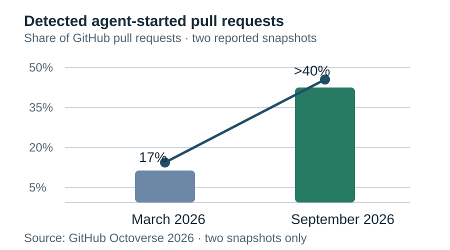
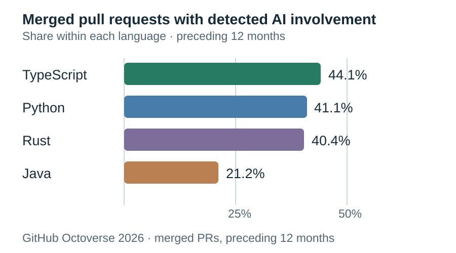
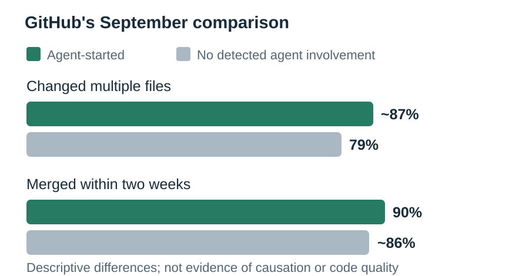
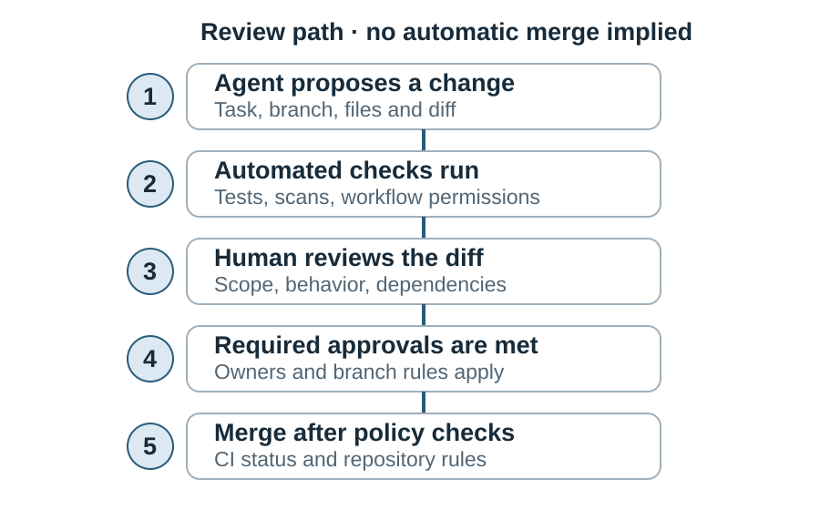

# GitHub says agents started more than 40% of PRs

**Dek:** GitHub’s September figure measures pull requests whose first draft the platform detected as agent-started—not the share of code written by AI, nor a measure of code quality.

**Byline:** Editorial Desk · **Reviewer:** Aman Mishra  
**Publication status:** Private draft; not published or scheduled  
**Prepared:** 31 October 2026 · **Updated:** 31 October 2026  
**Topic:** Developer & Workforce · **Reading time:** 8 minutes

## The bottom line

GitHub’s 2026 Octoverse report says that more than 40% of pull requests on its platform started with an agent’s first draft in September, compared with 17% in March. It counts a detectable event: an agent appears to have supplied the first draft. GitHub calls the measure a floor because some agent use may not be detected. It does not tell readers what share of code was generated, how much humans rewrote, or whether merged changes were correct, secure or maintainable. The report’s two-week merge figures are a comparison of observed repository activity, not a quality test. Teams should treat the headline as a reason to inspect their review system—not proof that agents have replaced developers or that the resulting code is safe. [1]

## Key facts at a glance

- GitHub published Octoverse 2026 on 28 October, using activity through September 2026. [1]
- More than 40% of September pull requests started with an agent’s first draft; the reported March figure was 17%. [1][9]
- GitHub reports 110 million agent-started pull requests in September, about six times March’s volume. [1]
- The share is detection-based; GitHub describes it as a floor, not a complete count of all AI assistance. [1]
- Among merged pull requests with detected AI involvement, GitHub reports 44.1% for TypeScript, 41.1% for Python, 40.4% for Rust and 21.2% for Java over the 12 months checked. [1]
- Agent-started pull requests more often changed multiple files: about 87%, compared with 79% for pull requests without detected agent involvement. [1]
- By September, 90% of agent-started pull requests had merged within two weeks, versus about 86% in the comparison group. [1]
- GitHub’s own guidance says generated changes still need careful human review and testing before merge. [2][3]

## What happened: a narrow series, not a universal adoption curve

| Date | GitHub’s reported measure | What it supports |
|---|---|---|
| March 2026 | 17% of pull requests started with an agent’s first draft. | A baseline in GitHub’s own platform data. [1] |
| February 2026 | 83% of agent-involved pull requests merged within two weeks, compared with roughly 86% without detected agent involvement. | A separate measure; the groups were close, with the agent group slightly lower. [1] |
| September 2026 | More than 40% of pull requests started with an agent’s first draft; 110 million in volume. | A later platform snapshot, not a forecast for all software development. [1] |
| September 2026 | 90% of agent-started pull requests merged within two weeks, compared with about 86% for the comparison group. | A merge-timing statistic, not a code-quality or security score. [1] |

The sequence is important. The 17% and “more than 40%” figures concern the detected share of pull requests that began with an agent first draft. The two-week figures concern whether a pull request merged during a time window. They are related signals in the same report, but they do not measure the same thing and cannot be combined into a single “AI productivity” score.

## Original visuals

### Detected agent-started pull requests

View data

| Month | Share reported by GitHub |
|---|---:|
| March 2026 | 17% |
| September 2026 | More than 40% |

Source: GitHub Octoverse 2026. The line joins two reported snapshots only; it does not imply monthly values or a continuous trend.

### Agent-started and comparison-group outcomes

View data

| Language | Merged pull requests with detected AI involvement |
|---|---:|
| TypeScript | 44.1% |
| Python | 41.1% |
| Rust | 40.4% |
| Java | 21.2% |

Source: GitHub Octoverse 2026, reported for the 12 months preceding publication. These percentages use a different measure from the share of pull requests started by an agent.

### Agent-started and comparison-group outcomes

View data

| Measure, September 2026 | Agent-started | No detected agent involvement |
|---|---:|---:|
| Changed multiple files | About 87% | About 79% |
| Merged within two weeks | 90% | About 86% |

Source: GitHub Octoverse 2026. These are descriptive group comparisons, not proof that agent use caused the difference.

### A review path, not an automatic merge

View data

| Stage | Evidence to inspect |
|---|---|
| Agent proposal | Diff, task context, changed files |
| Automated checks | Tests, security scans, workflow permissions |
| Human review | Correctness, scope, dependencies, maintainability |
| Approval | Required reviewers and branch rules |
| Merge | CI status and repository policy |

The stages are an editorial workflow model informed by GitHub’s review and branch-protection documentation, not a measured Octoverse funnel. [2][3][4][5]

### What 40% means—and what it does not

| It does mean | It does not mean |
|---|---|
| In GitHub’s September platform data, more than four in ten pull requests met its detected agent-started definition. | More than four in ten lines of code were written by AI. |
| A coding agent supplied the first draft for that detected group. | Every later edit was written by the agent or left unchanged by a human. |
| The platform saw about 110 million such pull requests in September. | The same share applies to every company, code host, programming language or country. |
| GitHub says the measure is a floor because it may not detect all agent use. | The metric is a complete census of AI use or a quality score. |

Keep the denominator attached to the number. “40%” without “of GitHub pull requests,” the September period and GitHub’s first-draft detection rule makes a narrow measure sound universal. The distinction also matters when an organization compares this figure with internal telemetry. A repository that logs accepted suggestions is counting something different from a platform that looks for an agent-created first draft. [1]

## What the measure counts—and leaves out

GitHub describes an agent-started pull request as one whose first draft came from a coding agent that GitHub can detect. That definition is narrower than “a pull request touched by AI.” A developer may ask a model for suggestions, manually write code based on them, or use a tool whose activity does not create a detectable agent-started draft. Those cases may not appear in the measure. Conversely, a pull request that begins with an agent draft may later be substantially rewritten by a person. [1]

That distinction changes the headline’s meaning. “More than 40%” is not a finding that agents authored 40% of GitHub’s code, that 40% of every developer’s work is automated, or that 40% of pull requests are accepted without human edits. It is a platform-specific share of pull requests meeting GitHub’s detection rule. The word “started” matters: it marks an entry point into the workflow, not the final distribution of authorship.

GitHub’s “floor” language also matters. It signals that the platform does not claim to observe every kind of agent involvement. Readers should preserve that limitation when comparing the percentage with a company’s internal metrics or another platform’s survey. Different systems may count prompts, generated lines, accepted suggestions, agent-created branches or pull requests. Without a shared definition and denominator, percentages that all say “AI use” are not directly comparable. [1]

## Merge speed is not a quality score

The September result that 90% of agent-started pull requests merged within two weeks can sound like an endorsement. The comparison group’s roughly 86% figure is close, and GitHub reports a different relationship earlier in the year: 83% of agent-involved pull requests merged within two weeks in February, slightly below the roughly 86% comparison rate. This is a descriptive change over time. It does not establish why the groups differed or whether the code was better. [1]

A merge can reflect many things: a small patch, a routine dependency update, a strong reviewer, a permissive repository policy, or a team that prioritizes throughput. The report’s two-week measure does not by itself disclose review minutes, defect rates, rollback frequency, vulnerability findings, downstream maintenance cost or whether a merge was later reverted. Those are different outcomes and need their own data.

The multi-file statistic raises another review question. GitHub says agent-started pull requests changed multiple files more often than the comparison group—about 87% versus 79%. A wider change can be sensible, but it can also make reasoning about scope and interactions harder. The percentage does not say whether those files were tightly related, whether tests covered them, or how many reviewers examined them. It should prompt teams to make review scope visible, not to treat multi-file work as inherently good or bad. [1]

GitHub also reports a separate language view: among merged pull requests with detected AI involvement over the preceding 12 months, the shares were 44.1% for TypeScript, 41.1% for Python, 40.4% for Rust and 21.2% for Java. These are not the same as the share of pull requests that began with an agent. The language metric concerns merged pull requests carrying a detected AI signal; the March-to-September measure concerns agent-started first drafts. The report does not establish that the language itself caused AI involvement or that the figures represent every repository using those languages. [1]

The language chart is useful as a prompt for better instrumentation, not as a ranking of languages or developers. A codebase’s age, project mix, repository visibility, team practices and detection coverage could all affect what appears in platform data. The figures should not be used to conclude that a language is “AI-native,” that its code is easier to review, or that one language’s developers need fewer reviewers.

## The review bottleneck is a team-level question

If agents increase the rate at which draft changes appear, teams need to know whether their review capacity, tests and ownership rules can keep pace. Octoverse does not measure a universal bottleneck: it reports platform activity, not every team’s queue or reviewer workload. The practical question for an engineering manager is local. Are pull requests waiting longer? Are reviewers handling larger changes? Are defects or reversions changing? Do teams have a reliable way to identify agent involvement in their own repositories?

Start with a baseline rather than borrowing GitHub’s percentage. Define the unit—a pull request, commit, generated line or accepted suggestion—then state the detection method, period and denominator. Separate agent-started changes from human-authored changes that received AI assistance. Track review latency, time to merge, review comments, test failures, post-merge defects and reversions as distinct measures. Do not collapse them into one productivity score.

Teams can also make review more consistent without treating the model as a special contributor that receives less scrutiny. GitHub documents ways to require human approvals on protected branches and describes human review and testing as necessary for agent-generated changes. NIST’s secure software and AI risk frameworks provide broader process references; they do not validate this Octoverse metric or prove that a particular workflow improves outcomes. [2][3][4][5][6][7]

### A worked example for a repository

The following numbers are hypothetical and demonstrate the calculation only. Suppose a team has 200 pull requests in one month, with 80 marked agent-started under a documented detection rule. If 64 of those 80 merge within 14 days, the team’s agent-started two-week merge rate is 64 ÷ 80 = 80%. If 96 of the remaining 120 pull requests merge within 14 days, the comparison rate is 96 ÷ 120 = 80%.

That result would say the two groups had the same observed merge rate in that period. It would not say they were equally correct, secure or maintainable. The team should publish the count alongside the rate, include the observation window, state how reopened or abandoned pull requests are handled, and track later defects separately. A small denominator can move sharply when only a few pull requests change status, so counts matter as much as percentages.

Do not compare that local result directly with GitHub’s 90% and 86% unless the internal team uses compatible definitions, observation windows and inclusion rules. GitHub reports an aggregate platform comparison; a single repository is a different population. The purpose of the worked example is to make a local measurement reproducible, not to reproduce GitHub’s published rate.

## What the record supports—and what it doesn’t

| Claim | Evidence | Assessment |
|---|---|---|
| More than 40% of September pull requests began with agent first drafts. | GitHub’s October 2026 report and GitGuardian’s summary. [1][9] | Supported as a GitHub-reported, detection-based statistic. |
| Agents wrote more than 40% of all code on GitHub. | The statistic counts detected agent-started pull requests, not code lines or total authorship. [1] | Not supported. |
| Agent-started pull requests merged faster in September. | 90% merged within two weeks versus about 86% in the comparison group. [1] | Supported as a descriptive time-window comparison; causation and quality are not established. |
| Agent-started pull requests changed multiple files more often. | About 87% versus 79% in the comparison group. [1] | Supported as a reported descriptive comparison. |
| The September merge figures prove agent code is safer or better. | The cited report does not provide a code-quality, vulnerability or maintenance measure for that claim. [1] | Not established. |

## What this means for…

**Engineering leaders:** Use the figures to ask whether your review system is keeping up, not to set an adoption target. Establish one internal definition of agent involvement, then report the denominator, period and detection method alongside every percentage.

**Developers and reviewers:** The first draft is only the start of review. Inspect the full diff, tests, dependencies and behavior at system boundaries. A quick merge is not a substitute for understanding what changed or why.

**Security teams:** Check that agent-created pull requests receive the same relevant security checks as other changes. Review workflow permissions separately from code content: GitHub’s documentation warns that untrusted pull-request content can create risks when privileged Actions workflows are configured unsafely. [5]

**Indian IT-services firms and GCCs:** The global platform number does not estimate Indian hiring or delivery changes. A firm can measure the task mix and review load of its own repositories, but should not infer staffing outcomes from GitHub’s detection metric.

## What we don’t know yet

1. How much human editing happens between an agent’s first draft and the merged pull request?
2. What are the defect, vulnerability, rollback and maintenance outcomes for the two groups?
3. How much agent involvement does GitHub’s detection rule miss, and does detection vary by repository or tool?
4. How do the results differ between public and private repositories? GitHub did not provide a public/private split in the passages checked.
5. How do language, repository size and project type affect the detected AI-involvement figures?

## What to watch next

- **In the next Octoverse update:** whether GitHub publishes its detection method, denominator details and comparable quality outcomes.
- **When teams report internal adoption:** whether they distinguish agent-started pull requests from AI-assisted human work.
- **During repository reviews:** whether required approvals, automated checks and reviewer ownership scale with change volume.
- **If the merge-rate comparison is reused:** whether the speaker preserves the time window and avoids calling it a safety or productivity result.

## FAQ

### Does “40% of pull requests” mean AI wrote 40% of all code?
No. GitHub says more than 40% of September pull requests started with an agent’s first draft under its detection method. The report does not measure the share of code lines generated by AI, the amount of later human editing, or all AI assistance that may not appear as an agent-started pull request.

### What does GitHub mean by an agent-started pull request?
GitHub describes it as a pull request whose first draft came from a coding agent that the platform can detect. That is a narrower category than any pull request where a developer used AI. It also says the metric is a floor because some agent use may not be detected.

### Do the merge figures show that agent code is better?
No. The report says 90% of agent-started pull requests merged within two weeks in September, compared with about 86% for pull requests without detected agent involvement. That is a descriptive timing comparison, not a measure of correctness, security, maintainability or later defects.

### How should an engineering team measure its own agent use?
Choose one unit and state the denominator, period and detection method. Keep agent-started work separate from human-authored work assisted by a model. Track merge timing, review effort, test failures and post-merge defects as separate outcomes; do not infer quality from throughput alone.

### Should agent-created pull requests get a different review standard?
The cited GitHub guidance recommends human review and testing before agent-generated changes merge, and repository owners can configure required approvals and checks. Teams should set policies based on risk and repository controls, not assume that an agent label makes a change safer or more dangerous by itself.

## Sources

**Tier 1 — primary**

1. GitHub, *Octoverse: Commits, pushes, reach new highs in 2026 as developers build with agents*, 28 October 2026. https://github.blog/news-insights/octoverse/octoverse-commits-pushes-reach-new-highs-in-2026-as-developers-build-with-agents
2. GitHub Docs, *Application card: GitHub Copilot Agents*, accessed 31 October 2026. https://docs.github.com/en/copilot/responsible-use/agents
3. GitHub Docs, *Review output from Copilot*, accessed 31 October 2026. https://docs.github.com/copilot/how-tos/agents/copilot-coding-agent/reviewing-a-pull-request-created-by-copilot
4. GitHub Docs, *About protected branches*, accessed 31 October 2026. https://docs.github.com/en/repositories/configuring-branches-and-merges-in-your-repository/managing-protected-branches/about-protected-branches
5. GitHub Docs, *Security hardening for GitHub Actions*, accessed 31 October 2026. https://docs.github.com/en/actions/security-guides/security-hardening-for-github-actions
6. NIST, *Secure Software Development Framework (SSDF) Version 1.1*, February 2022. https://csrc.nist.gov/pubs/sp/800/218/final
7. NIST, *Artificial Intelligence Risk Management Framework: Generative Artificial Intelligence Profile*, July 2024. https://nvlpubs.nist.gov/nistpubs/ai/NIST.AI.600-1.pdf
8. GitHub Docs, *Use GitHub Copilot code review across the pull request lifecycle*, accessed 31 October 2026. https://docs.github.com/en/copilot/tutorials/use-copilot-code-review-across-the-pull-request-lifecycle

**Tier 2 — reporting**

9. GitGuardian, *GitHub Octoverse 2026: AI Agents, Citizen Developers, and the New Security Reality*, October 2026. https://blog.gitguardian.com/github-octoverse-2026/

## Methodology note

This draft and its research were AI-assisted. Octoverse figures are attributed to GitHub and are not presented as independently audited measures. The article distinguishes the platform’s detected agent-started pull-request metric from AI-assisted coding generally. Product documentation describes GitHub’s own controls; NIST frameworks are cited as process references, not as evidence that a particular review process causes better outcomes.

## Corrections log

No corrections recorded. Private draft; not published.

## Related coverage

- [Coding-agent benchmark comparisons](https://www.globalainews.in/reports/coding-agent-benchmarks-compared/)
- [AI assistants compared](https://www.globalainews.in/reports/ai-assistants-compared/)
- [Hosted APIs versus open-weight models](https://www.globalainews.in/reports/hosted-vs-open-weight-models/)
- [Global AI News research register](https://www.globalainews.in/research/)

Planned cross-link after the related draft passes QA: Article 10 on delegated access for AI agents. No link is active until that draft exists and is cleared.

## Disclosure

Companies named in this article are subjects of our reporting. See our [editorial standards](/code-of-ethics/) for how we handle conflicts of interest.

## Subscribe

Subscribe to Global AI News for evidence-led coverage of AI, software and the technology economy.
