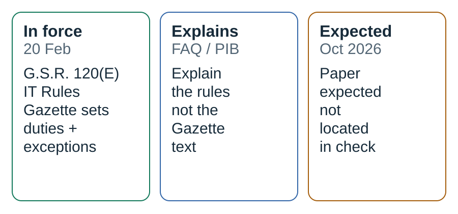
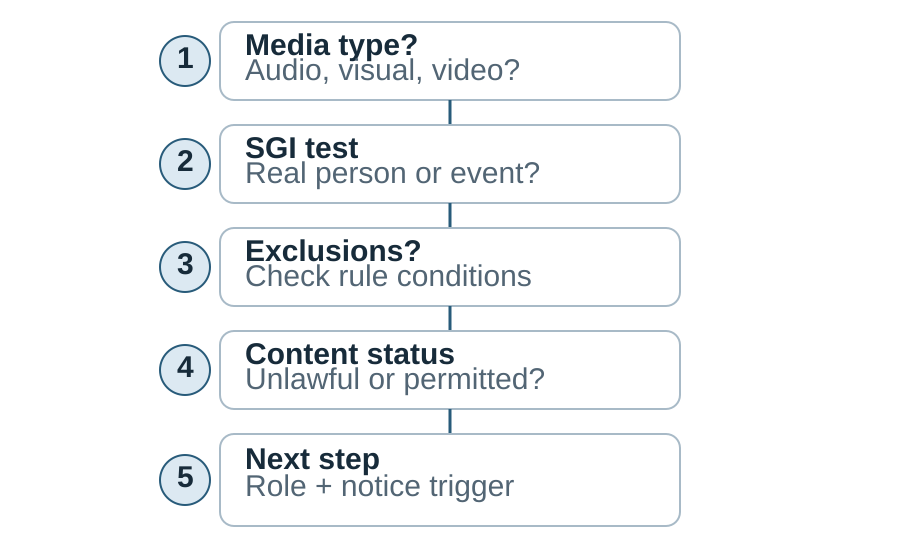
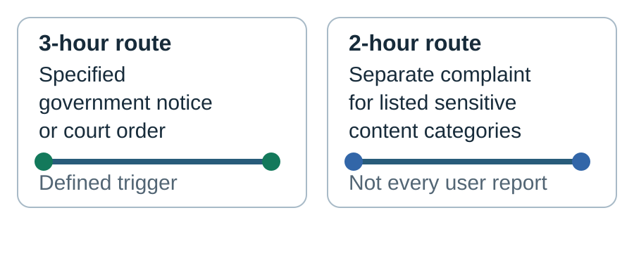

# India’s AI consultation paper: law, proposal and expectation

**Dek:** India already has binding rules for certain realistic synthetic media shared through intermediaries; a separate AI-governance consultation paper remains an attributed expectation, not a published law.

**Byline:** Editorial Desk · **Reviewer:** Aman Mishra  
**Publication status:** Private draft; not published or scheduled  
**Prepared:** 31 October 2026 · **Updated:** 31 October 2026  
**Topic:** India Watch · **Reading time:** 7 minutes

## The bottom line

India’s current framework and its next policy step are different things. The Information Technology (Intermediary Guidelines and Digital Media Ethics Code) Amendment Rules, 2026 were notified on 10 February and came into force on 20 February. They add due-diligence duties for intermediaries concerning specified synthetic audio, visual and audiovisual information. A separate consultation paper on broader AI governance was described by the IT minister as forthcoming in October and later as arriving “in the coming weeks,” according to two news reports. As of this draft’s 31 October check, we did not locate that paper on the official sources searched. The timetable is not itself a rule, and a consultation paper—if issued—would not automatically be binding law.

## Key facts at a glance

- The 2026 amendment is a change to the existing IT Rules, not a standalone AI Act. [1][2]
- SGI is defined around specified realistic audio, visual or audiovisual information—not every use of AI. [1]
- The Gazette text includes ordinary good-faith edits and accessibility improvements among exclusions, subject to the specific conditions in the rule. [1]
- A three-hour period relates to specified removal action after a qualifying government or court intimation—not a universal deadline for every AI-generated post. [1][3]
- The minister’s reported consultation-paper timetable is an expectation attributed to him, not a statutory deadline. [7][8]

## Timeline: what changed, and what is still expected

| Date | Event | Status |
|---|---|---|
| 22 October 2025 | MeitY published a draft amendment and explanatory note on synthetic information. | Proposal for consultation, not the final rule. [5][6] |
| 10 February 2026 | The government notified G.S.R. 120(E), amending the IT Rules, 2021. | Binding notification. [1] |
| 20 February 2026 | The amendment came into force. | In force. [1] |
| 30 July 2026 | PIB summarized the SGI framework and specified shorter response timelines. | Government explanation; the Gazette controls legal wording. [3] |
| 8 October 2026 | News on AIR reported the minister expected a broader AI-governance consultation paper within about a month. | Attributed statement. [7] |
| 26 October 2026 | MediaNama reported the minister later said the paper would come “in the coming weeks.” | Attributed statement. [8] |
| 31 October 2026 | This research check found no official consultation paper in the MeitY materials reviewed. | Search result, not proof that no document exists elsewhere. |

## Original visuals

### Status map: law, explanation and expectation

View data

| Item | Status at 31 October 2026 | Evidence |
|---|---|---|
| G.S.R. 120(E) amendment | In force from 20 February 2026 | Gazette [1] |
| MeitY FAQ and PIB summary | Explanatory material; not a replacement for the Gazette | FAQ [4], PIB [3] |
| Broader AI consultation paper | Not located in official sources checked; timetable reported as ministerial expectation | News on AIR [7], MediaNama [8] |

### Decision path for a media item

View data

| Step | Question |
|---|---|
| 1 | Is it audio, visual or audiovisual information? |
| 2 | Does it meet the rule’s realism and depiction test? |
| 3 | Does a conditional exclusion apply? |
| 4 | Is it unlawful/prohibited, or permissible with labelling and provenance duties? |
| 5 | Which intermediary role and notice/complaint route apply? |

### Two clocks, two triggers

View data

| Clock | Trigger | Scope |
|---|---|---|
| 3 hours | Qualifying government intimation or court order under the specified rule | Specified removal/action route; not every user report [1] |
| 2 hours | Complaint under the separate grievance provision | Listed sensitive categories; the exact rule and complaint conditions apply [1][4] |

## What the notified rules actually cover

The amendment adds SGI to the 2021 IT Rules. The definition covers audio, visual or audiovisual information altered using a computer resource so it appears real and depicts a person or event as indistinguishable, or likely to be perceived as indistinguishable, from a natural person or real-world event. The operative text—not a headline’s use of “deepfake”—sets the boundary. [1]

The definition concerns specified media, not every model use. The Gazette excludes some transformations if they do not materially alter or misrepresent the source: routine editing, technical correction, transcription and compression. It also excludes specified document, education, research and training preparation if it does not create a false record. Accessibility and translation improvements are excluded only when they do not manipulate a material part of the media. These are conditional, not blanket, exemptions. [1]

Intermediaries must take appropriate technical measures against SGI that violates applicable law. Permissible SGI is subject to prominent labelling and permanent metadata or another appropriate provenance mechanism, to the extent technically feasible. The final Gazette does not carry forward the 2025 draft’s fixed “10% of the display” or “first 10% of audio” formula. The earlier draft is context, not current law. [1][5][6]

Significant social media intermediaries (SSMIs) have additional duties: user declarations about whether uploads are SGI, plus reasonable and proportionate technical measures to verify declarations and ensure the required declaration or label is present. These are intermediary duties, not a single set of obligations shared by every creator or user. [1][2]

## Two clocks, two triggers

The phrase “three-hour takedown rule” can obscure the trigger. Under the amended Rule 3(1)(d), the three-hour window follows a qualifying intimation from the appropriate government or a court order. It is not a timer for every user report about AI-generated media. [1]

A separate grievance route sets two hours for listed sensitive categories under Rule 3(2)(b). MeitY’s FAQ gives an unlawful morphed intimate image as an example, but says it does not replace or amend the Act or Rules. The category and complaint conditions still matter. [1][4]

**Decision guide:** Is the material audio, visual or audiovisual? Does it meet the rule’s realism test? Does a conditional exclusion apply? Is it unlawful or otherwise prohibited, or permissible but subject to labelling/provenance duties? Which intermediary is involved? Which exact notice or complaint trigger applies? Each answer changes the next step; “AI-made” alone does not answer all of them.

## The paper is not the law

The consultation-paper story is separate. News on AIR’s 8 October report attributed to IT Minister Ashwini Vaishnaw an expectation that a paper would appear within about a month. MediaNama’s 26 October report attributed “in the coming weeks” to his remarks at the NDTV World Summit. Neither report is the paper itself or changes the February rules. [7][8]

The 2025 draft shows why status labels matter. It included a specific 10% marking formula; the final Gazette used different wording. An official draft is still a proposal, not an operative rule. [1][5][6]

For the wider consultation, the safe description is that the minister was reported as expecting a paper. A consultation would not by itself amend the IT Rules. Check the official document and process before updating this account. [1][2][7][8]

## What the record supports—and what it does not

| Claim | Evidence | Assessment |
|---|---|---|
| The 2026 SGI amendment is in force. | G.S.R. 120(E) says it took effect on 20 February 2026. [1] | Supported. |
| Every AI-generated text post is SGI. | The definition covers audio, visual or audiovisual information and applies a realism test. [1] | Not supported by this definition. |
| Every AI media complaint has a three-hour takedown clock. | The three-hour change concerns specified government/court intimations; a distinct two-hour route addresses listed sensitive categories. [1][4] | Overbroad. |
| The final rule mandates a fixed 10% watermark. | That formula appears in the 2025 draft, not in the final Gazette text. [1][5][6] | Not supported. |
| A broader AI consultation paper was published by 31 October. | The reports describe expected timing; no official paper was located in this check. [7][8] | Not established by the checked sources. |

## What this means for…

**Platforms and trust-and-safety teams:** Separate the qualifying government/court intimation from the user-grievance route. Record the trigger, receipt time, action and escalation; map each workflow to the exact clause with qualified legal review.

**Creators, publishers and accessibility teams:** The exclusions depend on not materially altering or misrepresenting the underlying media. Retain source files and edit notes where a transformation could be mistaken for a synthetic depiction. A disclosure does not make unlawful content lawful.

**Indian AI startups:** Distinguish realistic-media features from general text generation, and intermediary duties from provider or user responsibilities. If a service enables publication, determine its role and the applicable technical controls. Treat a future consultation as an opportunity to comment, not as a binding deadline.

## What we don’t know yet

1. What exact text, scope and questions will appear in the broader AI-governance consultation paper?
2. When will the paper be issued, and what response period or consultation process will accompany it?
3. How will MeitY or courts interpret difficult boundary cases involving material alteration, synthetic media, accessibility and technical feasibility?
4. What implementation evidence will show how intermediaries apply the distinct three-hour and two-hour processes?

## What to watch next

- **If MeitY publishes the paper:** verify the official date, consultation deadline and whether it proposes new duties or only seeks feedback.
- **When platforms update their policies:** compare each stated procedure with the operative rule rather than assuming a company help page restates the law.
- **If a court or ministry issues guidance:** check whether it changes interpretation, describes enforcement, or merely summarizes existing requirements.
- **At the next editorial update:** replace the “paper not located” note only after checking the official document itself.

## FAQ

### Is India’s AI consultation paper already law?
No. The timetable reported by news outlets is an expectation attributed to the IT minister. A consultation paper is a policy document, not automatically a binding amendment. The 2026 IT Rules amendment is a separate, notified instrument already in force.

### Do the rules cover every AI-generated text?
The SGI definition in the notified amendment covers audio, visual or audiovisual information meeting a realism test. It does not define every AI-generated text response as SGI. Other laws or rules may still apply to particular text, conduct or services.

### Is every deepfake complaint subject to a three-hour deadline?
No. The three-hour change applies to a specified process following a qualifying government or court intimation. The amendment also sets a separate two-hour route for listed sensitive categories of grievances. The trigger and category must be checked against the applicable clause.

### Did the final rules keep the 10% watermark requirement?
The 10% surface-area and audio-duration formula appears in MeitY’s 2025 draft. It is not stated in the same way in the final February 2026 Gazette text, which uses a prominent-labelling standard and provenance requirements, subject to the operative wording for the relevant actors and content.

### Does the MeitY FAQ replace the Gazette?
No. MeitY says the FAQ is explanatory and does not replace, amend or alter the IT Act or Rules. For the legal text, use the notified Gazette amendment and the consolidated Rules; the ministry expressly directs readers to the notified Rules for legal compliance.

## Sources

**Tier 1 — primary**

1. Government of India, Ministry of Electronics and Information Technology, *Information Technology (Intermediary Guidelines and Digital Media Ethics Code) Amendment Rules, 2026*, G.S.R. 120(E), 10 February 2026. https://egazette.gov.in/WriteReadData/2026/269993.pdf
2. MeitY, *The Information Technology (Intermediary Guidelines and Digital Media Ethics Code) Rules, 2021 [updated as on 10.02.2026]*, 10 February 2026. https://www.meity.gov.in/static/uploads/2026/02/550681ab908f8afb135b0ad42816a1c9.pdf
3. Press Information Bureau, *Government Enhances User Safety with Faster Removal of Unlawful AI-Generated Content and Strengthened Grievance Redressal Framework*, 30 July 2026. https://www.pib.gov.in/PressReleasePage.aspx?PRID=2291671&lang=1&reg=48
4. MeitY, *FAQs on the Information Technology (Intermediary Guidelines and Digital Media Ethics Code) Amendment Rules, 2026*, 2026. https://www.meity.gov.in/static/uploads/2025/10/065b6deb585441b5ccdf8be42502a49c.pdf
5. MeitY, *Explanatory Note: Proposed Amendments to the Information Technology (Intermediary Guidelines and Digital Media Ethics Code) Rules, 2021 in relation to synthetically generated information*, 22 October 2025. https://www.meity.gov.in/static/uploads/2025/10/8e40cdd134cd92dd783a37556428c370.pdf
6. MeitY, *Draft Information Technology (Intermediary Guidelines and Digital Media Ethics Code) Amendment Rules, 2025*, 22 October 2025. https://www.meity.gov.in/static/uploads/2025/10/9de47fb06522b9e40a61e4731bc7de51.pdf
**Tier 2 — reporting**

7. News on AIR, *AI Regulation Consultation Paper to Be Floated Within a Month: Ashwini Vaishnaw*, 8 October 2026. https://newsonair.gov.in/ai-regulation-consultation-paper-to-be-floated-within-a-month-ashwini-vaishnaw/
8. MediaNama, *India’s draft AI regulations could be out in November, says IT Minister Ashwini Vaishnaw*, 26 October 2026. https://www.medianama.com/2026/10/223-india-ai-regulation-consultation-paper-vaishnaw/

## Methodology note

This draft and its research were AI-assisted. Legal requirements are attributed to the notified Gazette text; MeitY’s FAQ and PIB summaries are treated as explanations, not substitutes for the operative rule. The consultation-paper timetable is attributed to the named reporting sources. This is informational journalism, not legal advice.

## Corrections log

No corrections recorded. Private draft; not published.

## Related coverage

- [India’s compute-gap report](https://www.globalainews.in/article/india-ai-compute-access-2026/)
- [IndiaAI compute and commercial-cloud comparison](https://www.globalainews.in/reports/indiaai-vs-commercial-cloud/)
- [Research register and methods](https://www.globalainews.in/research/india-ai-compute-2026/)
- [How Global AI News documents its methods](https://www.globalainews.in/research/)
- [Glossary: synthetic media and SGI](../glossary.md)

## Subscribe

Subscribe to Global AI News for source-linked reporting on AI policy and the technology economy.
